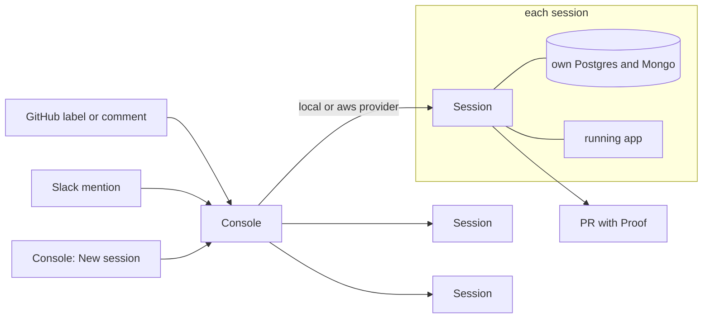

<div align="center">

# Woodshed

**Cloud dev environments for your coding agents.**

[](LICENSE-AGPL)


[woodshed.run](https://woodshed.run) · [Quickstart](#quickstart) · [How it works](#how-it-works) · [Self-hosting](#self-hosting) · [Docs](#documentation)

</div>

Woodshed is an open-source platform for running coding agents in cloud dev environments. Each task gets a container
with its own branch, a copy of your databases and a running copy of your app. The agent (Claude Code or Codex) makes
the change, tests it in a browser and opens a pull request. You follow every session from one console, and can take
over any of them.

## Quickstart

**Hosted:** sign up at [woodshed.run](https://woodshed.run) and connect a GitHub repository.

**Self-hosted:** you need Docker, Node 22 or later, git, the GitHub CLI (`gh`), and a Claude plan or an Anthropic API
key.

```bash
curl -fsSL https://woodshed.run/install | bash
```

It asks nothing: it builds a session image for any repository (a few minutes the first time) and opens the console at
`http://localhost:7690`. There, **Console settings**, Repos, **Add a repo** lists the repositories your `gh` login can
push to; each session clones its repository and installs its dependencies at start. **My settings** takes your Claude
token. Then press **New session** and say what you want built. Sessions push as you, so a GitHub App is optional on
your own machine. Everything it makes is in `~/.woodshed`, and `~/.woodshed/bin/woodshed` starts the console again.
`WOODSHED_TAILSCALE=1` also serves it to your own devices on your tailnet; a repository whose project file has
`databases` needs the install run again with `WOODSHED_REPO=owner/name`, which starts Postgres or Mongo for it
(`docs/self-host.md`, "On this machine").

**With a coding agent:** clone this repository and ask it to "set Woodshed up on this machine, following
`docs/self-host.md`" (or "on our server", or "on AWS", for `owner/name`). The runbook gives it a check after each step,
writes your repository's project file with it, and stops for the steps that are yours: picking the repository, your
Claude token, and on a server or AWS the GitHub App and any account, DNS or firewall.

## Features

- **Isolated environments.** Sessions don't share a branch, a database or an app, so they can run side by side.
- **Pull requests with proof.** The agent checks its change in a browser before opening the PR, and says in it what
  it couldn't check.
- **Review in the console.** The Review tab shows a session's diff with the agent's notes, and answers questions about
  any line.
- **Start from GitHub, the console or Slack.** Add the `woodshed` label to an issue, comment `/woodshed <what to do>`,
  or press **New session**.
- **Pause and resume.** An idle session pushes its work and stops. The next comment picks it up where it left off.
- **No credentials in sessions.** Sessions never hold cloud keys or production data.

## How it works



The console receives the request and starts a session through the provider. The session copies the database
template, checks out a branch, does the work, checks it in the running app, and opens a pull request. Later comments
and review feedback go back to the same session.

## Self-hosting

[woodshed.run](https://woodshed.run) runs the same code as this repository. To run it yourself:

| Where | Sessions run on | Secrets | Databases | Set up with |
| --- | --- | --- | --- | --- |
| Your laptop | Docker | Encrypted files on disk | Postgres and Mongo in Docker Compose | `curl -fsSL https://woodshed.run/install \| bash` |
| A bare-metal server or VM (Hetzner, OVH, …) | Docker on that machine | Encrypted files on disk | Postgres and Mongo in Docker Compose | [The server guide](providers/local/README.md#on-a-server-your-team-reaches) |
| AWS | Fargate, one task per session | Secrets Manager | RDS Postgres, and Mongo on the console's machine | Terraform: [the AWS guide](providers/aws/README.md) |

The first two use the `local` provider and the last uses `aws`. A server holds as many sessions as its cores and
memory allow; AWS adds Fargate tasks as you need them.

## Using it on your repository

Add a `.woodshed/project.yaml` to your repository. It tells a session what to install, which env files to write, how
to build the database and how to start the app. See [the project file](docs/reference.md#the-project-file) for every
field and a full example.

`node <woodshed>/shared/project.mjs check`, run from your repository, checks the file against your checkout. To run
the same check on pull requests that touch it, call the reusable workflow from one of your own:

```yaml
on:
  pull_request:
    paths: ['.woodshed/**', '.github/workflows/**']
permissions:
  contents: read
jobs:
  check:
    uses: ChifferCo/woodshed/.github/workflows/project-check.yml@main
```

[Setting it up](docs/self-host.md#before-any-of-them-the-project-file) has the steps.

## AI review on any repository

Any GitHub repository can run Woodshed's code review, merge-risk check and QA on its pull requests with no Woodshed
installation: the checks run in the repository's own GitHub Actions. The setup script writes the workflows, turns on the
one required setting, and asks for an `ANTHROPIC_API_KEY`:

```
scripts/enable-review.sh <owner/repo>        # review and merge risk
scripts/enable-review.sh <owner/repo> --qa   # also QA
```

It needs the GitHub CLI signed in with the `workflow` scope and admin on the repository. Then end a pull request's last
commit message with `[woodshed-review]` for a review, and add the `woodshed-qa` label for QA (on pull requests from a
branch in the repository, not forks). QA starts the app the way [the project file](docs/reference.md#the-project-file)
says, so there is nothing in the workflow to edit. Already running a Woodshed console? `--qa-runner woodshed` runs QA as
a [session](docs/reference.md#qa-in-a-woodshed-session) there instead of in CI.

See the [review](docs/reference.md#the-review-in-another-repo) and [QA](docs/reference.md#qa-in-another-repo) in another
repo to wire them by hand and for every option.

## Documentation

- Self-hosting: [step by step, for you or your agent](docs/self-host.md); in depth, [on your laptop or a server](providers/local/README.md) and [on AWS](providers/aws/README.md)
- [The console](console/README.md): sessions, sign-in, databases, Slack and settings
- [The session image](session/README.md): what runs inside each session
- [Reference](docs/reference.md): the project file, what a session can reach, and how the folders fit together
- [Troubleshooting](CLAUDE.md#by-symptom), by symptom

## Contributing

Questions go in Discussions and bugs in Issues. Woodshed is plain Node with no dependencies and no build
step: clone it and run `node --test`. Read [CLAUDE.md](CLAUDE.md) before your first pull request: it has the rules for secrets.

Woodshed is developed with Woodshed. Its own `.woodshed/project.yaml` is in this repository.

## License

Woodshed is copyright ChifferCo, Inc. ([COPYRIGHT](COPYRIGHT)) and licensed under [AGPL-3.0](LICENSE-AGPL), except
`ee/`, which holds paid features under a [commercial license](ee/LICENSE).

Contributions are accepted under the [Contributor License Agreement](CLA.md): see [CONTRIBUTING.md](CONTRIBUTING.md).
